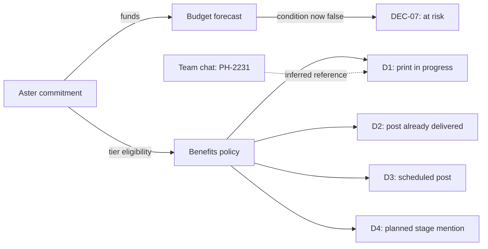

# MetaVision presentation outline

Eight slides, eight minutes including a two-minute demonstration. Reserve the following four minutes for questions. This is slide copy, speaker notes, visual direction, and an evidence checklist for transfer into PowerPoint or Canva.

## Current evidence and presentation boundary

Starting point: [demo plan and viva guide](demo-plan-and-viva-guide.md). Presentation base: `origin/main` at `cf84fd9`. The fetched backend branch is now available at `origin/codex/demo-core`, reviewed at `110bb11`. Its source is newer evidence than the guide's implementation-in-progress note.

One independent offline backend smoke run of `S1-main-demo` succeeded during this review. It reached plan v2, passed 21 runtime read-back checks, and replayed the trigger ten times with zero new effects. The [captured evidence](presentation-evidence.json) records the exact commit, mode, checks, and limited scope. This does not establish a running UI, live inference, production guarantees, or coverage of every dataset scenario.

The reviewed branch contains Python workflow/storage/tools/agents and pytest files. It does not contain `app.py` at this commit. Keep screenshots and a live UI demonstration pending until the implementation teammate provides them. Full pytest execution, Gemini calls, and restart recovery were not tested in this review. The current backend is a plain Python state machine, not a LangGraph runtime.

Do not put approximate action/flag counts on slides. The guide estimates them, while the inspected code produces different counts. A file-backed SQLite test is not proof of resumable workflow state after restart.

## Timing

| Slide | Subject | Seconds | Clock |
|---|---|---:|---|
| 1 | The coordination problem | 40 | 0:00-0:40 |
| 2 | Our response to a change | 40 | 0:40-1:20 |
| 3 | Aster's funding change | 45 | 1:20-2:05 |
| 4 | Agent collaboration and dependencies | 55 | 2:05-3:00 |
| 5 | Human control over existing commitments | 50 | 3:00-3:50 |
| 6 | Demonstration | 120 | 3:50-5:50 |
| 7 | Observed verification and replay | 55 | 5:50-6:45 |
| 8 | Prototype boundary and next steps | 45 | 6:45-7:30 |
| Buffer | Slide transitions or a slow demo step | 30 | 7:30-8:00 |

## Slide 1: The coordination problem

### On-slide copy

**MetaVision: Second Brain**

One sponsor changes a commitment. The event team must find every affected promise.

Email. Sponsorship tracker. Budget. Promotional work. Approvals.

### Visual

Show the incoming sponsor message beside the five affected areas. Reveal the areas on a click as the presenter names the consequences. Keep this a simple diagram with readable labels, not a screenshot collage.

### Speaker notes

"An event team spreads its decisions across messages, trackers, budgets, and documents. If a sponsor changes their contribution, an organizer has to work out which records and promises are now stale. Some promotional work may already be delivered. We chose Track B because detecting the message is only the start of the coordination problem."

Source: official brief, page 2, and the demo guide, section 1. The presentation uses a synthetic event, not an actual sponsor dispute.

## Slide 2: Our response to a change

### On-slide copy

**A reviewed plan for every affected record**

- Retrieve the source evidence and dependent commitments.
- Propose exact changes for human approval.
- Execute approved work and check the resulting records.

### Visual

One horizontal process: Understand, Map impact, Propose, Approve, Execute, Verify. Use native editable labels and connectors. Place a visible pause at approval. Do not add a second architecture diagram here.

### Speaker notes

"MetaVision reads the change and builds an impact plan from the current records. It shows what should change, what cannot safely change, and what still needs a person. The organizer approves the permitted actions. The system applies them through simulated tools, then reads the records again to check the result."

Source: guide sections 1 and 3. Describe this as the prototype's intended user experience. The backend flow has been exercised; the user interface still needs capture.

## Slide 3: Aster's funding change

### On-slide copy

**Aster Labs reduces its commitment**

| Measure | Before | Proposed after change |
|---|---:|---:|
| Aster commitment | ₹1,00,000 | ₹60,000 |
| Total commitments | ₹2,50,000 | ₹2,10,000 |
| Planned expenses | ₹2,20,000 | ₹2,20,000 |
| Forecast balance | +₹30,000 | −₹10,000 |

**DEC-07:** the optional DJ upgrade requires a forecast balance of at least ₹25,000.

Small visible caption: Synthetic commitments, not cash received.

### Visual

Use the forecast bridge specified below: +₹30,000 starting balance, −₹40,000 commitment change, −₹10,000 resulting balance. Keep expenses unchanged. The ₹25,000 DJ threshold is a separate decision condition, not an extra deduction in this bridge.

### Speaker notes

"Priya, Aster's registered contact, reduces the commitment by forty thousand rupees. Our forecast moves from a thirty-thousand surplus to a ten-thousand deficit. That also affects a decision the email never mentions: the optional DJ upgrade depends on a minimum twenty-five-thousand balance. We flag that decision as at risk. We do not invent a budget cut or reject it on behalf of the organizer."

Source: fixtures and guide section 2. Financial totals agree with the captured backend run. The trigger is November 14 at 06:10 IST; its proposal deadline resolves to November 15 at 18:00 IST. Do not restore the obsolete November 14 08:00 deadline from early drafts.

## Slide 4: Agent collaboration and dependencies

### On-slide copy

**Six roles, shared evidence**

| Role | Responsibility |
|---|---|
| Communication | Interpret the sponsor message and check the contact |
| Knowledge | Find affected records and their source evidence |
| Planning | Propose changes and surface unresolved issues |
| Coordinator | Control steps and approval pauses |
| Execution | Apply approved tool operations |
| Verification | Read records back and check the outcome |

### Visual

Use the small dependency cascade below as the main visual. Keep the role descriptions as speaker cues or a short footer if the table makes the slide crowded. Reveal the budget-to-DEC-07 path first, then the benefits-to-deliverables path. Show only the relevant subgraph, not all 46 fixture nodes.

This is a simplified impact view. Arrows explain consequences, not a verbatim dump of stored edge directions. The stored `DEC-07 CONTINGENT_ON budget` relation is traversed in reverse to discover the affected decision. The chat-to-D1 relation must remain visibly inferred.

### Speaker notes

"The Knowledge role follows dependencies. A reduction changes the forecast, which affects DEC-07. The benefits policy leads us to the sponsor's existing deliverables. A chat references print order PH-2231, which links to D1. We distinguish that inferred reference from declared relationships. Traversal stays scoped to Aster, so the shared policy does not drag other sponsors' work into the plan."

"These roles run sequentially in the reviewed prototype. Most safety-critical work uses deterministic Python. We are not claiming six independent model conversations or concurrent agents."

Source: guide sections 3-5, fixture graph, and inspected backend. Do not put LangGraph checkpointing on the current architecture slide. The stack shown here is Python, SQLite, simulated tools, with Streamlit UI planned and optional Gemini extraction unverified.

## Slide 5: Human control over existing commitments

### On-slide copy

**Existing work changes what the system can safely do**

| Item | Current state | Proposed handling |
|---|---|---|
| D1: banner logo | Printing, irreversible in this scenario | Flag for a human |
| D2: first social post | Published | Retain as the Silver post |
| D3: second social post | Scheduled | Propose cancellation, subject to a fresh version check |
| D4: stage mention | Planned | Propose cancellation and remove the run-sheet entry |
| DEC-07: DJ upgrade | Budget condition no longer holds | Mark at risk |

Business-record approval and internal-notification approval are separate. Sponsor sending stays unapproved in this demo.

### Visual

Use a progressive state matrix rather than another network graph. Reveal proposed handling only after showing existing states. Keep the sponsor reply visibly marked **Draft, not sent**.

### Speaker notes

"A tier change cannot undo work that already happened. D1 is already printing. D2 is already published and satisfies Silver's one-post allowance. D3 can be cancelled only while it is still scheduled. D4 is still planned. Our organizer can approve business changes and internal updates separately. The reply to the sponsor remains a draft because sending it needs its own scope."

The Silver package also requires sponsor-wall coverage. Do not claim cancelling D1 automatically creates that coverage. Keep the unresolved coverage issue visible if the final application reports it. Local approver selection demonstrates a control flow, not production authentication.

Source: guide section 2, fixture policy/deliverables, backend approval scopes. Initial plan means proposed effects, not already-applied changes.

## Slide 6: Demonstration

### On-slide copy

**A transient failure and a changing record**

1. Review the impact and approve plan v1.
2. Recover from the tracker failure.
3. Detect that D3 changed and request delta approval.
4. Verify final records and replay the message.

### Required screenshot or recording placeholders

- `[CAPTURE PENDING: impact preview and plan v1 approval]`
- `[CAPTURE PENDING: tracker fail-once event and successful retry]`
- `[CAPTURE PENDING: D3 version conflict and plan v2 delta]`
- `[CAPTURE PENDING: final read-back and duplicate replay result]`

Keep these as production notes in the draft. Replace them with actual captures before presenting. If no UI arrives, use a clearly identified backend walkthrough or recording. Never show a mock interface as a working application screenshot.

### Two-minute run of show

| Demo time | Presenter action | Explain |
|---|---|---|
| 0:00-0:25 | Open the prepared scenario and impact | Registered sender, revised commitment, dependent work |
| 0:25-0:45 | Approve business records and internal notifications | Sponsor send remains off |
| 0:45-1:10 | Execute and show the tracker retry | Failure happened before writing; retry the same operation |
| 1:10-1:35 | Show D3 conflict and approve the v2 delta | Another actor published it; preserve that edit and revise affected content |
| 1:35-2:00 | Verify and replay | Show actual checked records, then new-effect count |

### Speaker notes

"The tracker fails before it writes, so retrying the same operation is safe. The D3 event is different: another actor publishes it after approval. The expected version is stale. We stop the cancellation, refresh state, and build plan v2. D3 remains published and becomes over-delivery. Changed actions require fresh approval. Previously committed work is reused."

Do not imply these failures occurred in real Gmail or social platforms. They are deliberate faults in persistent simulated tools. Do not claim a timer chart measures latency unless the final application records actual timing.

## Slide 7: Observed verification and replay

### On-slide copy

**Observed in one offline backend smoke run**

- Main scenario reached plan v2 and a verified outcome.
- Runtime read-back: **21 passed, 0 failed**.
- Trigger replay: **10 duplicate deliveries, 0 new effects**.
- D3 stayed published. The sponsor reply stayed unsent.

Small visible caption: Backend `110bb11`, deterministic mode, one scenario. UI and live Gemini not validated in this review.

### Visual

Replace the draft area with actual read-back and ledger evidence. Use one readable excerpt, not dozens of tiny log lines. Keep a separate small label for static fixture checks: **24 scenarios available; 43 corrupted fixture cases rejected**. Those are dataset facts, not application-test coverage.

### Speaker notes

"We exercised the backend's main scenario independently. It reached a revised plan, passed twenty-one read-back checks, and produced no additional effects across ten duplicate deliveries. These results concern this commit, scenario, and deterministic mode. Our dataset contains twenty-four scenarios, but we have not established application coverage for all of them. We also retain unresolved business issues such as the funding deficit and irreversible printing."

Source: [presentation-evidence.json](presentation-evidence.json), especially `verification`, `replay`, and `test_scope`. Re-run and refresh these numbers if presenting a different commit. A verified workflow result does not mean every business problem has been solved.

## Slide 8: Prototype boundary and next steps

### On-slide copy

**What this prototype demonstrates**

Evidence-based impact analysis, scoped approvals, retry versus replan, and read-back verification in a synthetic workspace.

**Next steps**

Broader scenario coverage, authenticated approvers, durable workflow resume, and one live connector.

Small visible disclosure: Simulated applications. Sequential Python orchestration. No real emails, posts, or calls sent in the reviewed run.

### Speaker notes

"The current boundary is one synthetic event workflow with simulated applications. We demonstrate how the system treats failures and changing commitments. Real-service authentication, uncertain delivery, and durable workflow recovery need further work. Our next step is to expand the scenario tests and connect one application while preserving the approval and verification contracts."

Keep Vapi/Telegram as optional roadmap items unless the final team build actually integrates and tests them. Do not let calling become the headline for this submission.

## Dynamic visuals to prioritize

Use three visuals only. Give each a distinct job. For the deck, native chart objects and appear/morph builds are sufficient. A separate dashboard is not required. Manual clicks are more predictable than a looping animation during questions.

### A. Progressive dependency cascade: why records are affected

**Primary visual for slide 4.** A small network diagram with about ten nodes. This explains context engineering and second-order impact.

Build frames:

1. Existing Aster commitment and baseline records, all neutral.
2. New email highlights the proposed commitment reduction.
3. Reveal the budget path and DEC-07's failing condition.
4. Reveal policy and D1-D4 with their different lifecycle constraints.
5. Reveal the dashed chat-to-print-order reference and its source label.

Use textual labels alongside color. Draw declared relationships solid and inferred ones dashed. Keep other sponsors outside the main cascade or muted as unaffected context. Freeze node positions between frames so the audience follows the change. Label the preview as proposed impact until approval/execution occurs.

### B. Forecast bridge: what changed financially

**Primary visual for slide 3.** A three-column waterfall, in INR:

| Column | Value | Geometry |
|---|---:|---|
| Initial forecast | +30,000 | Total bar from zero to +30,000 |
| Aster reduction | −40,000 | Floating change from +30,000 to −10,000 |
| Revised forecast | −10,000 | Total bar from zero down to −10,000 |

Show a zero line and directly label every amount. Reveal the reduction and revised balance on successive clicks. Caption: planned expenses remain ₹2,20,000; cash received remains ₹0 in this fixture. If a decision-threshold line at +₹25,000 is shown, label it explicitly as DEC-07's condition. Do not subtract the optional DJ cost a second time or suggest a real bank balance changed.

### C. Execution sequence: why retry differs from replan

**Supporting visual for slide 6 or a backup slide.** Use a small event timeline with lanes for Coordinator, Execution, Human, and Verification.

Show: approval v1, tracker failure before write, safe retry, D3 external publish, version conflict, plan v2, delta approval, read-back, duplicate replay. Keep reused business work visibly unchanged when v2 appears. A short callout says "Retry: same operation, unchanged intent" beside the tracker and "Replan: record state changed" beside D3.

Use numbered event order rather than time-proportional widths. No measured latency or parallel speed-up data exists in this review. Label it as a workflow sequence when constructed from the scenario rather than captured application events.

### Optional only if the live UI already supports it

A plan v1/v2 delta table showing reused, previously covered, and fresh-approval actions. It can replace a dense timeline, not become a fourth primary chart. Use the actual plan data from the final build; avoid estimated action counts.

### Skip

Full force-directed graph, 3D animation, confidence gauges, radar scores, model-speed comparisons, decorative live counters, and invented productivity percentages. None helps demonstrate the required causal chain with our present evidence.

## Capture request for the implementation teammate

Send the following request through the team's existing channel. This document does not send it automatically:

> Please provide the final commit SHA, exact run command, and whether the demo uses rules or live Gemini. We need: impact/approval screenshot, tracker retry, D3 conflict with v2 delta, final verification/replay evidence, and a 60-120 second fallback recording. Include the scenario and mode in captures. Hide API keys, environment settings, and unrelated windows. Confirm whether app.py is pushed and whether the final build supports restart recovery. Please report actual test results separately from dataset-validation results.

## Four-minute Q&A cues

- **Why six agents?** Separate interpretation, retrieval, planning, execution authority, verification, and routing. These are bounded roles in a sequential prototype, not evidence that more agents always perform better.
- **Where is the AI?** The inspected backend uses deterministic parsing and graph/rule logic. Gemini is optional design work until an actual call is demonstrated. Describe the selected final mode honestly.
- **Why a graph?** It traces the budget condition and deliverables that a message alone does not enumerate. Show the path and evidence.
- **Why not cancel everything after the tier drops?** Existing work can be irreversible or already delivered. Version checks protect concurrent edits.
- **What does replay prove?** The observed duplicate source deliveries and committed operations added no effects in this run. This is not a universal exactly-once guarantee for third-party systems.
- **Does SQLite provide crash recovery?** It stores records and an operation ledger. The reviewed workflow's in-memory approvals/stage do not provide durable resume across restart.
- **Did all 24 scenarios pass?** No. The dataset contains 24 cases. The evidence here is one independently exercised backend scenario; the full pytest suite was not run in this review.
- **Did you solve the deficit?** No. The system detects it and exposes its dependencies for human decisions.

## Before submission

- Replace pending captures with actual output or select a clearly labeled backend fallback.
- Recheck the final demo commit and mode, then refresh slide 7 evidence if changed.
- Keep the presentation to eight slides and rehearse to 7:30 plus buffer.
- Use one readable visual per slide, with large type. Put details and source references in notes.
- Export a PDF/static fallback and keep the recording offline.
- Confirm the actual submission cutoff with organizers; earlier brief sections disagree.
