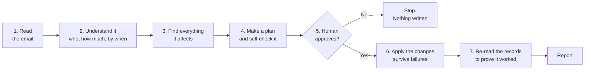
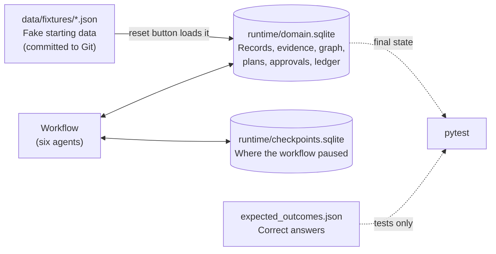
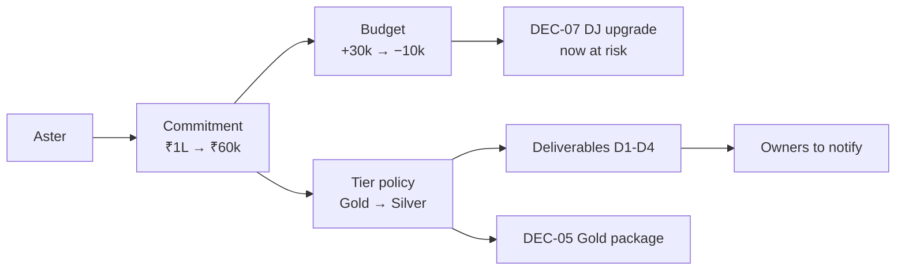
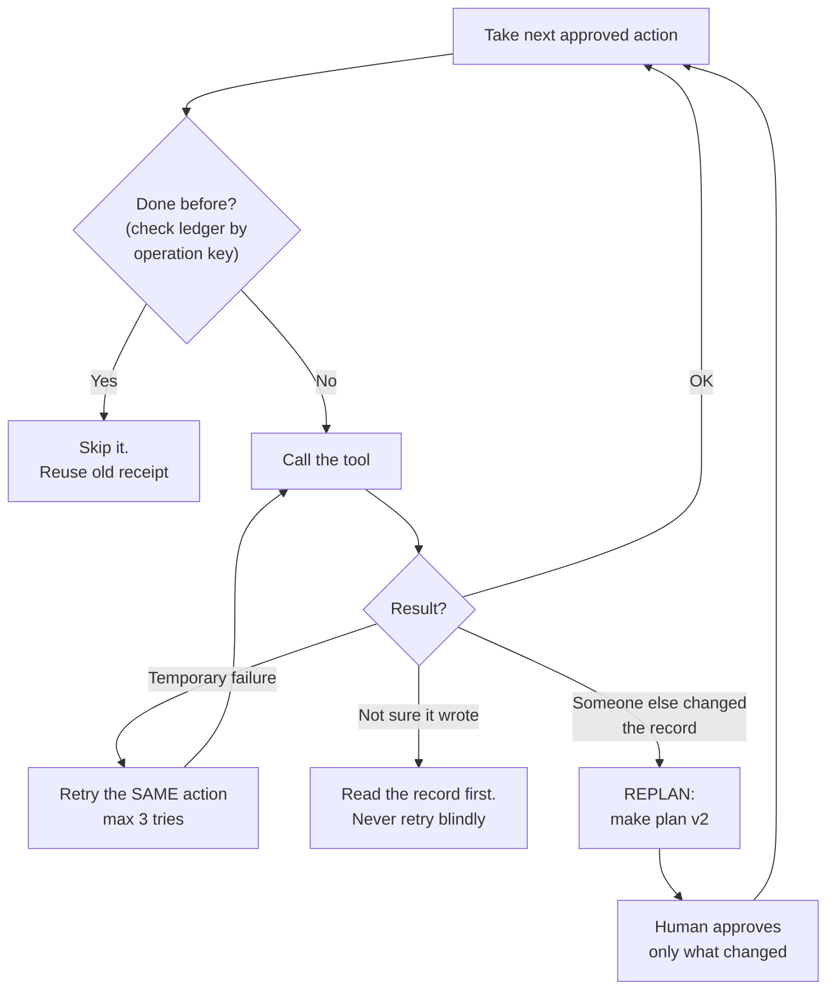
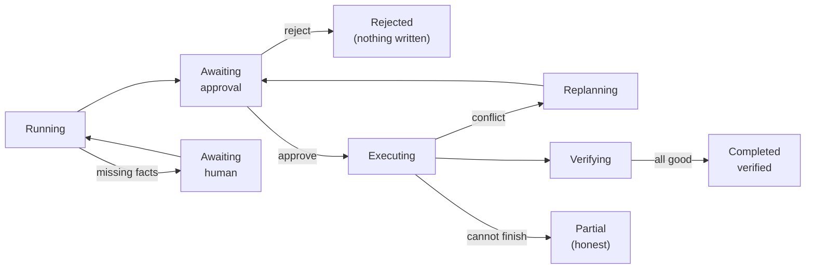

# Second Brain: the architecture in plain words

**For our team only.** This is a simplified reading guide for [PROJECT_B_SYSTEM_FLOWCHART.md](PROJECT_B_SYSTEM_FLOWCHART.md) and [PROJECT_B_BLUEPRINT.md](PROJECT_B_BLUEPRINT.md). It leaves out detail on purpose. If anything here disagrees with the blueprint, **the blueprint wins**. Nothing described here is built yet.

---

## 1. The problem in one paragraph

A college fest's information is spread across email, team chat, a sponsor tracker, a budget sheet, documents and a calendar. One sponsor emails to say "we are cutting our money from 1 lakh to 60k". That one email quietly breaks many things: the budget goes negative, the sponsor drops from Gold to Silver, some promised promotions must be cancelled, some are already done and can't be undone, and an expense that depended on the budget is now at risk. Our system finds all of that, proposes the fixes, asks a human, applies the approved fixes, survives failures along the way, and then **checks** that the fixes really happened.

Everything is fake (simulated apps, made-up data), but the tools really read and write a SQLite database.

---

## 2. The demo story (scenario S1)

**Setting:** Innovision Campus Fest 2026, held November 21-22. Simulated time is "now" = **14 Nov, 06:30 IST** (`DEMO_NOW`). We never use the real PC clock.

**Trigger email** (from Priya N., Aster's authorized contact, 14 Nov 06:10):
> "We need to revise Aster Labs' commitment from INR 100,000 to INR 60,000. Please send an updated benefits proposal by 18:00 IST tomorrow."

| Thing | Before | After |
|---|---|---|
| Aster commitment | ₹1,00,000 (Gold) | ₹60,000 (Silver, if organizer approves) |
| Total sponsor money | ₹2,50,000 | ₹2,10,000 |
| Planned expenses | ₹2,20,000 | ₹2,20,000 (unchanged) |
| Budget balance | **+₹30,000** | **−₹10,000 deficit** |
| DEC-07 (DJ upgrade ₹25k, allowed only if balance ≥ ₹25k) | condition OK | **at risk**. Flag it, don't reject it |
| DEC-05 (approve Aster's Gold package) | pending | replaced by a new Silver-package decision |
| Review meeting | none | one calendar item, 15 Nov 12:00 (before the 18:00 deadline) |

The DEC-07 line is the **second-order cascade**: the email never mentions the DJ, but less money means less budget, which means the DJ condition now fails. Judges should see that we found it.

---

## 3. The big picture: 7 steps

Golden rule: **an email only proposes a change. It never directly edits a financial record.** Nothing important gets written before step 5.

---

## 4. The six agents

Think of them as six people with strict job descriptions. Each one has its own inputs, outputs and permissions. They are functions (LangGraph nodes) inside one Python app, not separate servers.

| Agent | Job in one line | Like a... | Uses the LLM? | Can change business records? |
|---|---|---|---|---|
| **Coordinator** | Decides which agent goes next and writes down why | Project manager | No | No |
| **Communication** | Reads the email and pulls out the facts; later writes draft replies | Secretary | **Yes** (or fixture mode) | No, only drafts |
| **Knowledge** | Looks up current records and finds everything connected to Aster | Librarian | No | No |
| **Planning** | Turns the impact into an exact to-do list with before/after values | Planner | Optional, for explanation text only | No |
| **Execution** | Runs only the approved actions, retrying safely | Worker | No | **Yes**, only what was approved |
| **Verification** | Checks the plan before approval and the results after execution | Auditor | No | No |

Only **one** agent really needs the LLM. Everything with money, rules or permissions is plain Python, so the model can never invent an amount or approve something.

Every handoff between agents is saved as an `AgentMessage`. The UI shows these as a timeline, which is how judges see the orchestration.

---

## 5. Where the data lives

- **Fixtures** are the clean starting point. The reset button reloads them.
- **domain.sqlite** is the live, changing world: sponsors, deliverables, decisions, documents, calendar, chat, outbox, plus our own records (plans, approvals, receipts, audit).
- **checkpoints.sqlite** is LangGraph's bookmark, so a paused run survives a restart.
- **expected_outcomes.json** is the answer key. **Agents must never see it.** Only tests read it.

Both `runtime/` files are ignored by Git and regenerated each time.

---

## 6. Step 3 in detail: finding what is affected (the knowledge graph)

The graph is just two SQLite tables (entities and edges). Each edge says how one thing depends on another and points to evidence.

- **Declared edge:** written in our fixtures, e.g. "Aster's commitment contributes to the budget".
- **Inferred edge:** found by the Knowledge agent by matching names and IDs in chat, e.g. a chat message mentioning "Aster" and print order "PH-2231" links D1 to that order. Shown dashed and labeled in the UI.

---

## 7. Step 4 in detail: what to do with each promotion

Some promises are already done. This is what the brief means by "mid-stream".

| ID | Promise | State | Silver still entitled? | What we do |
|---|---|---|---|---|
| D1 | Logo on main-stage banner (print order PH-2231) | being printed, **can't undo** | no | `flag_human`: a human decides |
| D2 | Social post 1 | **already published** | yes (Silver gets 1 post) | `no_op_satisfied`: nothing to do |
| D3 | Social post 2 (16 Nov) | scheduled, can undo | no | `cancel` (needs approval) |
| D4 | Stage mention in run sheet | planned, can undo | no | remove it (needs approval) |

Rule of thumb: **never cancel work that is already done or can't be undone. Flag it for a human.**

Before a human sees the plan, Python runs **8 named rules** (`EVT-*`). Each gives pass / fail / unknown with evidence:

| Rule | Checks |
|---|---|
| SRC | Is the email real, explicit and from an authorized person? |
| FIN | Budget recomputed correctly, in paise (integer money) |
| BEN | Benefits change follows the tier policy |
| DLV | Each deliverable classified as in the table above |
| DEC | Conditional decisions (DEC-07) rechecked |
| DEP | Every affected thing has an action or a reason why not |
| APR | Every write has an approval for its exact content |
| VER | After execution, actual records match what was approved |

Then the **Verification agent does a preflight**: an independent check of the plan. If it finds a problem, the plan goes back for fixing (at most 2 times) before any human sees it.

---

## 8. Step 5: the human approval

- The workflow **pauses** (LangGraph `interrupt`) and shows: the evidence, exact before/after values, the deficit, the D1 and DEC-07 warnings.
- The human approves **three separate scopes**:
  1. business records (tracker, docs, decisions, calendar)
  2. internal team notifications
  3. sending the reply to the sponsor (unchecked by default)
- The approval is locked to a **plan hash**, a fingerprint of the exact plan. If anything changes later, the old approval no longer counts.
- Reject means nothing is written.

---

## 9. Step 6: execution and the four reliability moments

This is the heart of the demo.

| # | Moment | What happens | What it proves |
|---|---|---|---|
| 1 | **Tracker fails once** (injected) | Execution retries the same action with the same operation key; second try works | Recovery |
| 2 | **D3 published early** (injected: the social lead posts it just before we cancel it) | Cancel fails with a version conflict → Knowledge re-reads → Planning makes **plan v2**: D3 is now "already done", so flag it instead of cancelling → preflight → human approves **only the changes** → continue. The sponsor update already done is **not** repeated | Adaptive replanning (it's in the track title, so it must work) |
| 3 | **Same email arrives again** | Recognized as already processed; zero new writes, posts or calendar items | Idempotency / no duplicates |
| 4 | **App restarts while waiting for approval** | Same run, same plan, still waiting | Durable memory |

Key difference: a **temporary failure is a retry. A changed record is a replan.**

Every write is "set commitment to 60,000", never "subtract 40,000". That way a retry can't apply the change twice.

---

## 10. Step 7: verification and report

The Verification agent reads the records again, fresh, and checks for example:
- Aster = ₹60,000, cash received unchanged
- balance = −₹10,000
- D2 untouched, D3 flagged (after the conflict), D4 removed, D1 untouched and flagged
- DEC-05 superseded (not deleted), DEC-07 `at_risk`
- exactly one review calendar item
- Brightline and Corvex untouched

Only after business records pass do the approved team notifications get posted, and the sponsor reply gets "sent" only if scope 3 was approved. Otherwise it stays a draft.

The final report says honestly what changed, what was verified, and what still needs a human (D1, the deficit, DEC-07). **A "success" message from a tool is never treated as proof.**

---

## 11. Run states (simplified)

---

## 12. Words you will see

| Word | Meaning |
|---|---|
| `DEMO_NOW` | Fake "current time" fixed in the scenario |
| paise | Money stored as integer paise (₹1 = 100 paise), so there are no decimal errors |
| fixture mode | LLM replaced by a prepared answer, for offline work and tests. Labeled in the UI |
| context bundle / context hash | The facts given to an agent, plus their fingerprint |
| preflight | Verification checking the plan **before** approval |
| read-back | Verification re-reading records **after** execution |
| plan hash | Fingerprint of the exact plan the human approved |
| delta approval | Approving only what changed in plan v2 |
| operation key | Stable ID for one intended change; the same key means the change won't be done twice |
| ledger / receipt | Log of every write and its result |
| version conflict | The record changed since we read it, so our write is refused |
| `flag_human` | "We can't fix this automatically. A human must decide" |
| `no_op_satisfied` | "Already fine, nothing to do" |
| interrupt / thread_id | LangGraph pause, and the ID used to resume the same run |

---

## 13. Where to read more

| Want detail on... | Full flowchart section | Blueprint section |
|---|---|---|
| Whole flow | §1 | §5 |
| Data and storage | §2 | §9, §17 |
| Reading and understanding the email | §3 | §8, §10 |
| Graph, rules, planning | §4 | §9.4, §11 |
| Approval | §5 | §13 |
| Failures, retry, replan | §6 | §11.3, §14 |
| Verification and outputs | §7 | §15 |
| Test scenarios | §9 | §17, §18 |

## 14. Build order (blueprint §19.1)

1. Fixtures + `expected_outcomes.json` for S1
2. SQLite tables, reset, tools, operation ledger
3. One deterministic S1 test, end to end, no LLM
4. Wire the six agents in LangGraph with checkpoints
5. Inject faults: tracker retry, then the D3 conflict and replan
6. Streamlit UI
7. Live LLM extraction
8. Inferred edges, notifications, summary → then P1 extras

Never cut: approval, duplicate safety, evidence links, read-back verification, the replan path.
