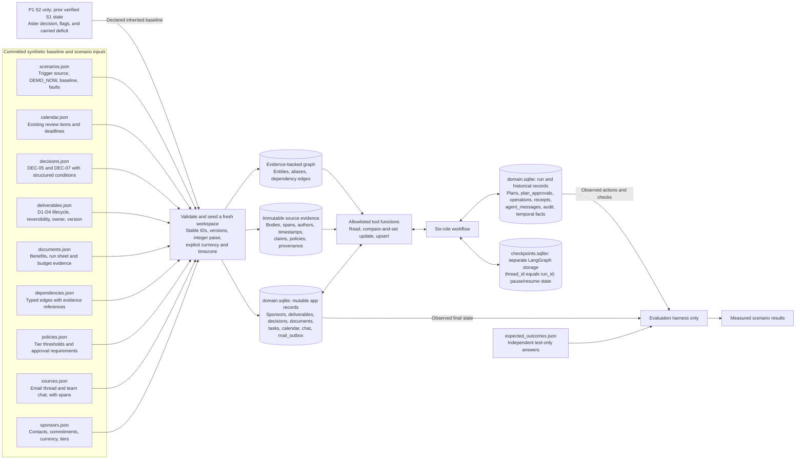
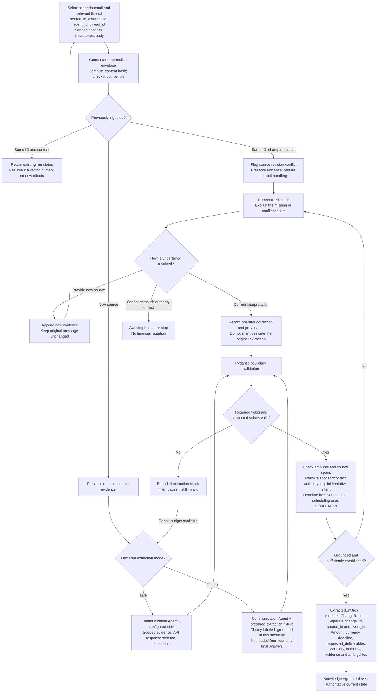
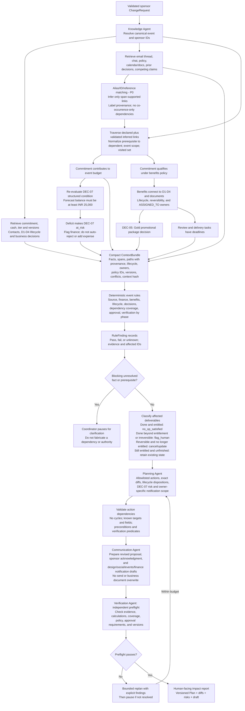
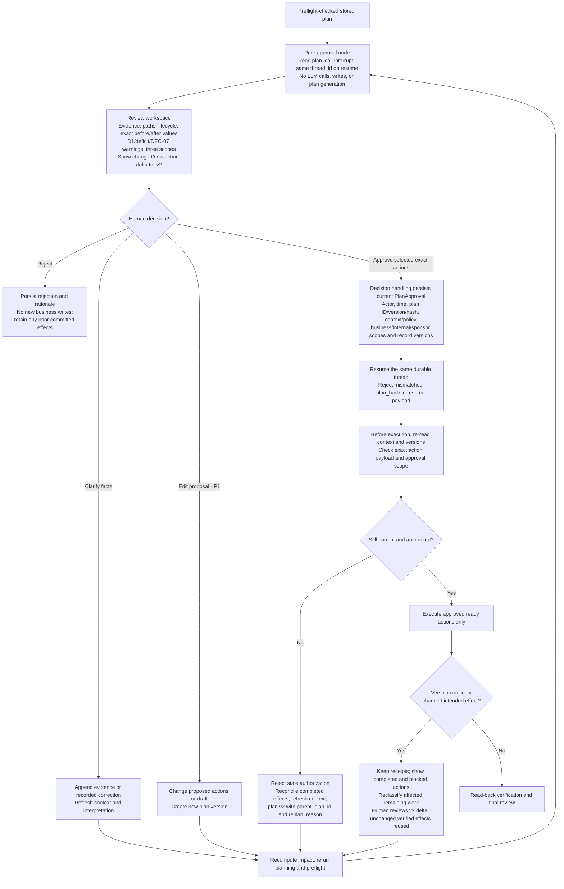
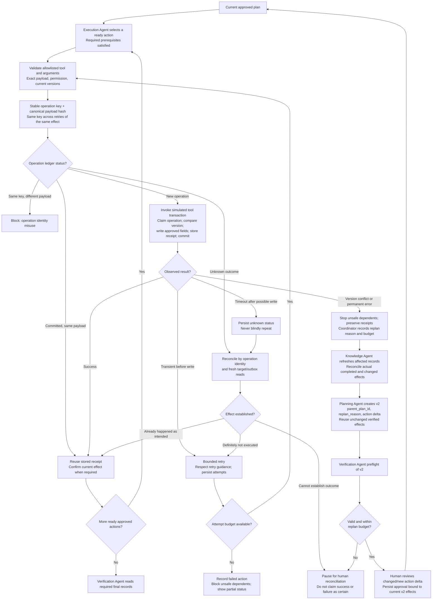
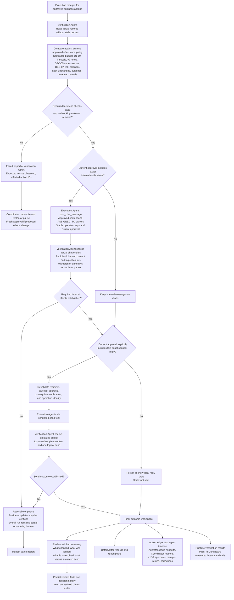
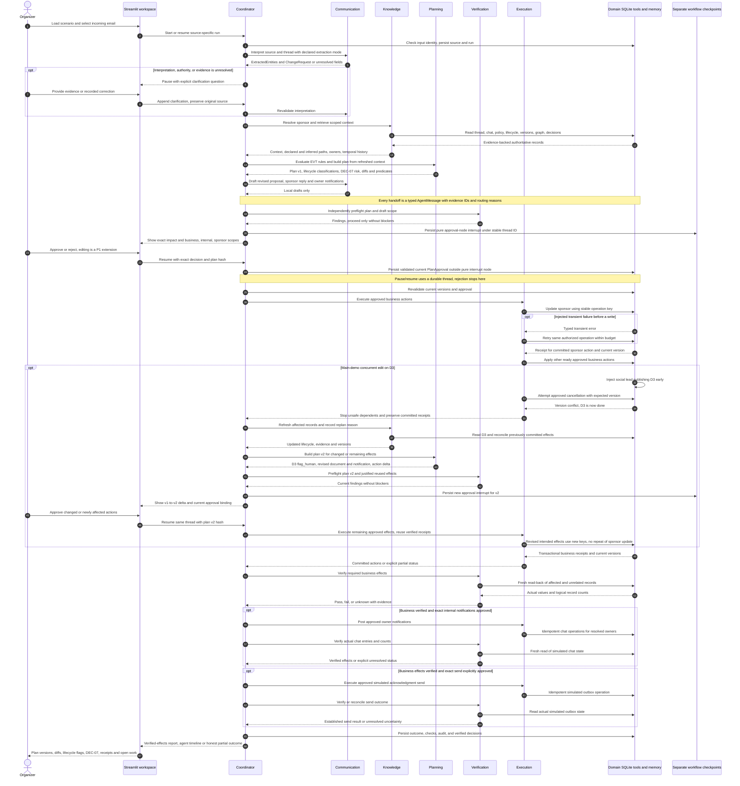
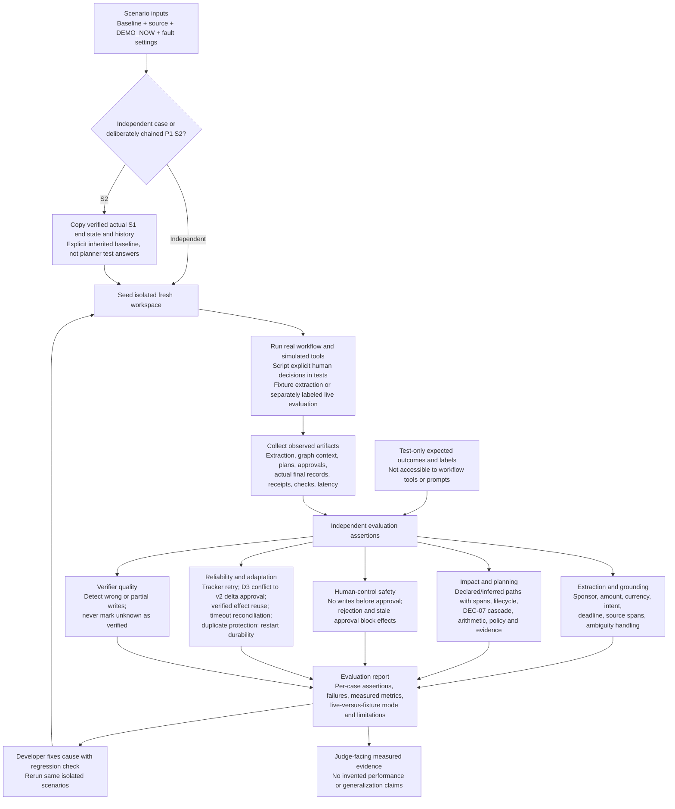
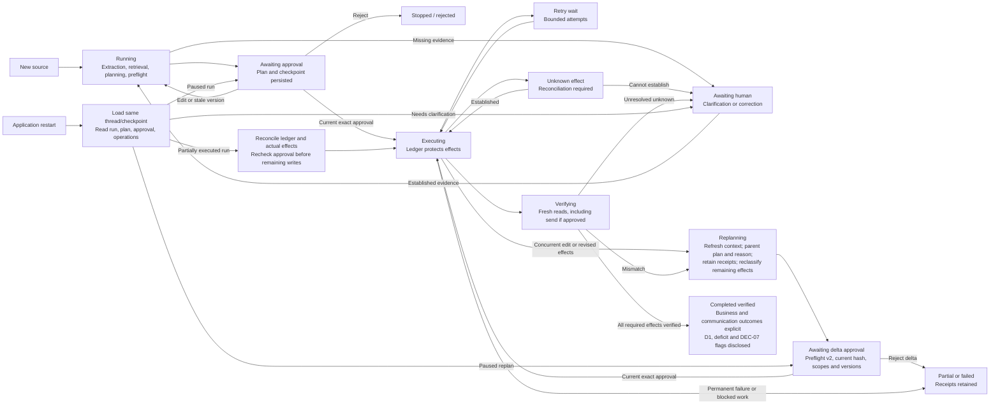

# MetaVision / Second Brain: complete system flowcharts

**Design visualization, not implemented functionality.** This document turns the agreed [Project B blueprint](PROJECT_B_BLUEPRINT.md) into a navigable workflow. It does not introduce a second architecture or claim that any agent, connector, test, or dashboard already works.

**Aligned with blueprint revision 2**, retrieved at repository commit `a0f113e` (blueprint change `e57be24`). The main demo includes mid-stream deliverable classification, the second-order `DEC-07` cascade, a transient tracker retry, and a concurrent D3 edit followed by delta re-approval. All diagrams describe proposed behavior, not existing functionality.

**Prototype boundary:** one Python application, six bounded agent roles, LangGraph orchestration, Pydantic validation, and one Streamlit workspace. Five simulated apps (Mail, Team chat, Tracker, Docs, Calendar) will perform actual persistent reads and writes. Domain data and workflow checkpoints use separate SQLite files. A configured live LLM is optional; fixture-mode extraction must be visibly labeled.

Read the diagrams in order. One enormous diagram would hide the important approval and failure branches, so the overview is followed by focused views.

## Contents

1. [Whole-system overview](#1-whole-system-overview)
2. [Dataset, simulated applications, and persistent memory](#2-dataset-simulated-applications-and-persistent-memory)
3. [Email ingestion, extraction, and factual corrections](#3-email-ingestion-extraction-and-factual-corrections)
4. [Knowledge graph, context, and impact planning](#4-knowledge-graph-context-and-impact-planning)
5. [Human review, corrections, and approval](#5-human-review-corrections-and-approval)
6. [Execution, tool failures, and recovery](#6-execution-tool-failures-and-recovery)
7. [Verification, response email, and final outputs](#7-verification-response-email-and-final-outputs)
8. [End-to-end agent and human interaction](#8-end-to-end-agent-and-human-interaction)
9. [Evaluation pipeline and scenario matrix](#9-evaluation-pipeline-and-scenario-matrix)
10. [Run states and restart behavior](#10-run-states-and-restart-behavior)
11. [Concrete sponsor-change walkthrough](#11-concrete-sponsor-change-walkthrough)
12. [Agent inputs, outputs, and authority](#12-agent-inputs-outputs-and-authority)
13. [Build order, scope, and non-negotiable boundaries](#13-build-order-scope-and-non-negotiable-boundaries)

## 1. Whole-system overview

**Read this first:** a message proposes a change; it does not directly change a financial record. The system establishes evidence, discovers dependencies, proposes exact changes, gets approval, executes, and checks the observed result.

```mermaid
flowchart TD
    FIX["Synthetic event dataset<br/>Email thread, chat, sponsors, budget,<br/>policies, deliverables, decisions, docs, calendar"] --> SEED["Seed a fresh SQLite demo workspace<br/>Fixed DEMO_NOW; explicit scenario faults"]
    SEED --> APPS["Persistent simulated applications"]
    APPS --> IN["Incoming sponsor email or message"]
    IN --> C["Coordinator Agent<br/>Create or resume a run; enforce limits"]
    C --> D{"Existing source ID<br/>and same content?"}
    D -->|Yes| OLD["Show or resume existing run<br/>Do not create duplicate effects"]
    D -->|No| COM["Communication Agent<br/>Extract entities, proposed change,<br/>deadline, requested deliverables, source spans"]
    COM --> VAL{"Valid, grounded,<br/>authorized, unambiguous?"}
    VAL -->|No| CLAR["Human clarification or factual correction<br/>Preserve original evidence"]
    CLAR -->|New evidence or recorded decision| COM
    VAL -->|Yes| K["Knowledge Agent<br/>Resolve identity; read thread, chat, policy,<br/>declared/inferred paths, owners, versions, history"]
    K --> RULE["Eight deterministic EVT rules<br/>Financial impact, lifecycle classification,<br/>benefits, dependency coverage, contingent decisions"]
    RULE --> P["Planning Agent<br/>Versioned plan, exact diffs, lifecycle dispositions,<br/>DEC-07 risk, dependencies, and verification predicates"]
    P --> COMD["Communication Agent<br/>Draft revised proposal, sponsor reply,<br/>and per-owner internal notifications"]
    COMD --> PRE["Verification Agent: preflight<br/>Independently check plan and evidence"]
    PRE --> PC{"Blocking finding?"}
    PC -->|Yes| BOUND["Coordinator: bounded replan<br/>Pause for a human if still unresolved"]
    BOUND -->|Within replan budget: refresh context| K
    BOUND -->|Budget exhausted| PART
    PC -->|No| H["Human review through pure approval interrupt<br/>Business records, internal notifications,<br/>sponsor-send scope; v2 delta if replanned"]
    H --> DEC{"Approve, edit,<br/>reject, or clarify?"}
    DEC -->|Clarify or P1 proposal edit| NEW["Record correction; refresh context<br/>Create new plan version"]
    NEW --> K
    DEC -->|Reject| STOP["Stop or reject delta<br/>No further business writes;<br/>preserve any prior committed effects and receipts"]
    DEC -->|Approve| A["Persist current PlanApproval<br/>Exact hash, actions, three scopes,<br/>actor, context, policy and record versions"]
    A --> STALE{"Approval and relevant<br/>record versions still current?"}
    STALE -->|No| NEW
    STALE -->|Yes| E["Execution Agent<br/>Run only approved, ready tool actions"]
    E --> TOOLS["Update tracker, tier, benefits, deliverables,<br/>DEC-05/DEC-07, run sheet, calendar<br/>Budget computed from commitments"]
    TOOLS --> RES{"Tool result?"}
    RES -->|Transient or uncertain| REC["Bounded retry or read-back reconciliation<br/>Stable operation key; no blind repeat"]
    REC -->|Safe to continue| E
    REC -->|Unresolved| PART["Partial or awaiting human<br/>Keep receipts; block unsafe dependents"]
    RES -->|Concurrent D3 edit or other conflict| REPLAN["Keep committed receipts; stop unsafe dependents<br/>Refresh actual state; plan v2 for remaining/changed effects<br/>D3 done becomes flag_human, not cancel"]
    RES -->|Permanent failure| REPLAN
    REPLAN --> BOUND
    RES -->|Committed| MORE{"More ready approved<br/>business actions?"}
    MORE -->|Yes| E
    MORE -->|No| V["Verification Agent: read-back<br/>Fresh amounts, lifecycle states, decisions,<br/>counts, approvals, and unrelated-record checks"]
    V --> PASS{"Approved business<br/>effects verified?"}
    PASS -->|No| REPLAN
    PASS -->|Yes| INT["Execute and verify approved internal notifications<br/>Owners from ASSIGNED_TO edges<br/>Otherwise keep drafts; pause on unknown outcomes"]
    INT --> SEND{"Current sponsor reply<br/>explicitly approved?"}
    SEND -->|No| DRAFT["Keep acknowledgment as a draft<br/>Do not claim delivery"]
    SEND -->|Yes| OUT["Execution Agent: simulated send<br/>Revalidate send approval; protect against duplicates"]
    OUT --> OV["Verification Agent<br/>Check simulated outbox state or reconcile uncertainty"]
    OV --> FINAL["Verified-effects report or honest partial status<br/>Evidence, diffs, receipts, checks, unresolved work"]
    DRAFT --> FINAL
    MEM[("runtime/domain.sqlite<br/>Evidence, graph, temporal facts, domain records<br/>Plans, approvals, operations, handoffs, audit")]
    CP[("runtime/checkpoints.sqlite<br/>Separate LangGraph workflow checkpoints")]
    C -.-> MEM
    C -.-> CP
    K -.-> MEM
    A -.-> MEM
    E -.-> MEM
    V -.-> MEM
    FINAL -.-> MEM

    classDef human fill:#fff3cd,stroke:#a16207,color:#422006;
    classDef agent fill:#e0f2fe,stroke:#0369a1,color:#082f49;
    classDef safe fill:#dcfce7,stroke:#15803d,color:#14532d;
    classDef caution fill:#fee2e2,stroke:#b91c1c,color:#450a0a;
    class H,CLAR,DEC human;
    class C,COM,COMD,K,P,PRE,E,V,OV agent;
    class FINAL,A safe;
    class STOP,PART,REPLAN caution;
```

**Arrow key:** solid arrows show control/data flow. Dotted arrows show persistence, not permission to overwrite arbitrary records. The Coordinator owns routing across the entire run, not just its first box. Repeated Verification and Execution boxes are phases of the same roles, not extra agents.

Every handoff is a stored `AgentMessage`; every Coordinator route has a reason. The UI exposes this timeline alongside the business action ledger. Replan paths refresh context and return through preflight and approval; unchanged verified effects are reused, never blindly replayed.

**Success means the approved effects were verified and required flags recorded.** D1's irreversible print order, the INR 10,000 deficit, and `DEC-07` can still require organizer decisions; the system must not claim those real-world issues were solved merely because it raised flags. A required unknown effect blocks a verified-completion status.

## 2. Dataset, simulated applications, and persistent memory

There are three different kinds of information: committed source fixtures, mutable runtime records, and test-only answers. Keeping them separate is essential.

| Data layer | What it contains | What it must not become |
|---|---|---|
| Source evidence | Original sponsor email, policy, sender mapping, exact quoted spans | An editable financial record or an instruction granting tool permissions |
| Knowledge graph | Event-scoped entities and justified relationships | Guessed links based only on words appearing together |
| Domain records | Current commitments, deliverable lifecycle, business decisions, documents, calendar and communication state | A model summary treated as financial truth |
| Run records | Versioned plans, workflow approvals, actions, receipts, handoffs, routing reasons, correction decisions | A replacement for checking actual tool effects |
| Temporal history | Verified facts with `valid_from`, `valid_to`, `recorded_at`, `superseded_by`; closed historical facts retained | A last-write-wins summary that erases prior decisions |
| Checkpoints | Where the workflow paused and what step resumes | The sole protection against duplicate writes |
| Test expectations | Independently specified correct results for prepared cases | Planner context, agent tools, or model prompt content |

**Reset is an explicit operation on the synthetic workspace only.** It reloads committed fixtures into ignored runtime storage. It must not erase the shared fixtures, silently run on UI refresh, or target real accounts.

Domain records, evidence, graph, ledger, and history share `runtime/domain.sqlite`; the database boxes are conceptual table groups, not separate database servers. `runtime/checkpoints.sqlite` is a separate file. Independent cases start fresh; P1 S2 deliberately starts from S1's verified actual end state to demonstrate long-term memory, never from test answers injected into agent context.

## 3. Email ingestion, extraction, and factual corrections

Example input (`mail-aster-002`, November 14 at 06:10 IST): authorized Aster contact Priya N. says, “We need to revise Aster Labs' commitment from INR 100,000 to INR 60,000. Please send an updated benefits proposal by 18:00 IST tomorrow.” The thread also contains the original commitment; chat records establish work already done or in production.

`source_id = mail-aster-002` identifies the evidence; `event_id = event-innovision-2026` identifies the college event; `change_id` identifies the proposed change. These are not interchangeable. `ExtractedEntities` preserves spans for sponsors, amounts, people, deadlines, and deliverables. Unknown information stays unknown.

“Tomorrow” resolves to `2026-11-15T18:00:00+05:30` from the source timestamp. `DEMO_NOW = 2026-11-14T06:30:00+05:30` controls scheduling checks, not the PC's wall clock. The internal review proposal is November 15 at 12:00 IST.

**Important distinction:** the email's “old amount” is a claim. The current tracker value is the execution precondition. A disagreement is surfaced, not silently patched.

### Three kinds of correction

| Correction | Example | Safe route |
|---|---|---|
| Extraction correction | Model reads INR 60,000 as INR 6,000 | Preserve original result; record correction and source span; rerun validation and impact calculation |
| Evidence clarification | Two authorized contacts provide conflicting commitments | Preserve both sources; request an explicit clarification or recorded adjudication with provenance |
| Proposed-action correction | Organizer changes the requested review time or rejects a benefits reduction | Create a new plan version, rerun preflight, and obtain fresh approval |

Correction is not approval. An operator fixing an extracted amount does not authorize a tracker update. Detailed editing controls are a P1 UI enhancement; the P0 system can pause for clarification and process a new source without a full inline editor.

Model/network failure must not produce a silent fallback presented as live intelligence. If an operator explicitly switches to fixture mode, show that choice and its limitations in the run report.

## 4. Knowledge graph, context, and impact planning

Eight rule IDs from revision 2 make the checks inspectable:

| Rule | Meaning |
|---|---|
| `EVT-SRC-001` | Source, amount/currency, identity, and authority are established |
| `EVT-FIN-001` | Financial totals are recomputed using integer paise |
| `EVT-BEN-001` | Benefits changes follow a cited policy and valid approval scope |
| `EVT-DLV-001` | Classify deliverable status, reversibility, and entitlement; never cancel already-done or irreversible work |
| `EVT-DEC-001` | Re-evaluate conditional decisions; failed conditions produce `at_risk`, not automatic rejection |
| `EVT-DEP-001` | Affected known dependencies have actions or explicit dispositions |
| `EVT-APR-001` | Execution requires approval of the exact current payload and versions |
| `EVT-VER-001` | Fresh observed records match intended approved effects |

Before approval, the approval rule marks actions as **requiring approval**; it must not reject every draft plan merely because a human has not approved it yet.

The model can explain language and suggest a plan. Python owns arithmetic, graph traversal, action validation, permission gates, and authoritative verification. A graph diagram is an explanation of retrieved relationships, not proof of them.

In the impact graph, declared edges can be solid and inferred edges dashed; both show evidence. This graph-provenance convention is separate from dotted persistence arrows in the system diagrams. An inferred-only route to an action is called out for human review. A future obligation that remains entitled is retained, not falsely marked delivered: `no_op_satisfied` must never change an unfinished deliverable to `done`.

## 5. Human review, corrections, and approval

The human is part of the workflow at multiple points, not just a final “yes” button.

### What the approval must show

- Who is approving and what source evidence supports the change.
- The exact sponsor amount, currency, benefits, document content, task changes, and calendar details.
- The budget before and after, including any remaining deficit.
- Which actions are approved, omitted, or still blocked.
- Three independent scopes: business records, internal notifications, and sponsor-facing send (unchecked by default).
- Draft versus approved simulated send status for each recipient; owners resolved through `ASSIGNED_TO`, not invented.
- Record versions and the immutable plan version/hash being approved.
- The v1-to-v2 action delta, edge provenance, D1's irreversible state, and the failed `DEC-07` condition.
- Any unsupported action, irreversible effect, or unresolved authority issue.

Changing the amount, recipient, document wording, deadline, or relevant context after approval cannot reuse the old approval. Retries of the exact same authorized operation do not need a new plan merely because the tool was temporarily unavailable.

**Delta approval is a smaller human review, not weaker authorization.** Persist a current v2 approval binding with explicit coverage of the final actions. Unchanged prior approvals may be referenced only after checking unchanged payloads, relevant versions, policy, and scope; changed or newly affected actions are included in the delta for fresh approval. Committed effects still satisfying v2 are reused through verified receipts, not executed again. Never simply apply a v1 plan hash to v2.

The approval node restarts from its first line on LangGraph resume. Keep it pure; generation and decision persistence belong outside that interrupt-only node. Re-approval loops through workflow edges, not a loop that regenerates a plan inside the paused node.

A demo approver selector is sufficient to show workflow mechanics. It is not production authentication. Reads, impact calculations, local drafts, and audit records can happen before approval; consequential business writes cannot.

## 6. Execution, tool failures, and recovery

**Three different identities:**

1. **Input identity:** source system plus external message ID; content hashes detect revisions.
2. **Operation identity:** source change, target, action type, and intended effect; not a random run ID.
3. **Attempt identity:** one try of that operation, with its own number, timestamp, and error.

For local simulated tools, the mutation and operation receipt should commit together in SQLite. Set the approved absolute commitment to 6,000,000 paise; do not subtract 4,000,000 paise on every retry.

Suggested prototype limits from the blueprint: three total attempts per transient action and two replans per run, then pause. Fail-once injection persists its fired state, so a Streamlit rerun cannot cause the same action to fail forever.

**Recovery is not blind rollback.** If a tracker update succeeded but a document tool failed, preserve that fact and propose a safe forward repair. Revised effects require fresh approval. Duplicate protection for local transactional tools does not establish universal exactly-once email delivery through future external APIs.

**Mandatory main-demo replan:** a simulated social lead publishes D3 just before its cancellation. The cancellation's version check fails. Refresh shows D3 is now `done`, so plan v2 replaces cancellation with `flag_human`, revises the benefits document and notification draft, passes preflight, and requests delta approval. The committed sponsor update is not repeated. A changed document payload gets a new intended-effect operation key; it cannot reuse an old key with different arguments.

Transient failures are retries; version conflicts are replans. Unknown effects are reconciled before either route. A permanent calendar outage can produce a P1 fallback reminder-task proposal requiring approval, while the original outcome remains explicitly partial until required work is resolved.

## 7. Verification, response email, and final outputs

The outgoing acknowledgment and internal owner notifications are created by Communication, reviewed in their separate approval scopes, and posted/sent only by Execution after required business verification. Generating a draft is not a send. In this prototype, simulated chat posts and outbox entries are persistent app records, not real Slack/WhatsApp/Gmail delivery. A revised sponsor message after replanning needs approval for its exact new content.

| Output | What the human or judge sees |
|---|---|
| Structured change | ExtractedEntities and ChangeRequest: separate IDs, amount, currency, deadline, requested deliverables, spans, authority, certainty |
| Context and impact | Current commitment, policy, declared/inferred paths, lifecycle, owners, budget and second-order decision impact |
| Rule findings | Named checks with evidence and pass/fail/unknown results |
| Proposed plan | Exact diffs, lifecycle dispositions, dependencies, risks, versions, sponsor/internal drafts, v2 delta and reason |
| Approval record | Actor and exact current actions per business/internal/sponsor scope, parent references where justified |
| Execution evidence | Per-operation receipts, attempts, failures, reconciliation decisions |
| Collaboration timeline | Typed AgentMessage handoffs, Coordinator route/reason, interrupted and resumed plan versions |
| Verification report | Actual reads versus approved effects; residual mismatches |
| Communication status | Per-owner chat and sponsor reply: draft, simulated posted/sent, blocked, unknown; never invented delivery |
| Final summary | Verified changes, D1 and D3 flags where applicable, deficit, DEC-07 risk, and remaining organizer decisions |
| Evaluation report | Independently measured test results, not self-rated agent confidence |

Show concise evidence-backed rationales, not hidden model chain-of-thought.

## 8. End-to-end agent and human interaction

This view shows ownership over time. The Coordinator drives all transitions and persists the run; the other roles do not grant themselves permissions.

The straight path is illustrative, not an unconditional success promise. Rejection, stale context, permanent failures, and unclear send outcomes take the branches shown in the detailed diagrams.

## 9. Evaluation pipeline and scenario matrix

**Runtime verification and offline evaluation are different.** Runtime verification reads records and checks approved predicates. Offline evaluation uses independent test-only expectations to establish whether the system performed correctly across prepared scenarios.

### Prepared scenarios

| Scenario | Expected behavior | What it evaluates |
|---|---|---|
| S1 authorized funding reduction | Classify D1-D4, compute deficit and DEC-07 risk, approve and verify | Primary end-to-end workflow |
| S1 concurrent D3 edit - P0 | Refresh done state, replace cancellation with flag, preflight v2, approve delta, no repeated effects | Mandatory adaptive replanning |
| S2 Brightline increase - P1 | Start from verified S1 history; 90k to 100k makes balance zero, but DEC-07's 25k condition still fails | Data-driven behavior and long-term memory |
| Tentative reduction or missing currency | Ask for clarification; no consequential write | Intent and uncertainty handling |
| Unknown sender changes a commitment | Authority unresolved; block financial actions | Source authority |
| Contradictory authorized messages | Preserve both; obtain clarification instead of silently picking latest | Conflict handling |
| Duplicate email, replayed at least 10 times | Same logical effects; no duplicate calendar items or sends | Input and operation idempotency |
| Tracker fails once before writing | Bounded retry, one mutation, successful read-back | Transient recovery |
| Timeout after successful write | Establish observed effect before another attempt | Uncertain-outcome reconciliation |
| Record edited while approval is pending | Old approval cannot execute; revised plan needs fresh approval | Version binding |
| Human rejects the proposal | No consequential business writes | Effective human control |
| Wrong or partial tool write | Verifier detects mismatch; no false completed status | Independent verification |
| Restart while awaiting approval | Same thread, plan, and approval state resume | Durable memory |
| Malicious instruction inside an email | No permission bypass or arbitrary tool execution | Untrusted-input safety |
| Permanent tool failure | Preserve completed work, block unsafe dependents, report partial status | Honest failure handling |

This is the target evaluation set, not a claim that all cases are implemented. The primary P0 demo includes both the fail-once tracker write and the concurrent D3 edit with replan/delta approval. S2 recall, broader contradictory-message scenarios, and inline correction UI are P1. Independent tests isolate runtime state; S2's inherited verified state is a deliberate declared exception.

### Metrics to record, not assume

- **Grounded extraction accuracy:** decision-critical fields correct against independent labels; report unsupported claims and correctly unresolved fields separately.
- **Dependency coverage:** relevant dependents found versus the independently defined affected set; report unrelated dependents selected as well.
- **Approved-effect correctness:** required actual record values match the approved outcome.
- **Unauthorized writes:** zero before approval, after rejection, or under stale approval.
- **Duplicate effects:** zero additional effects across repeated replay; compare logical record counts and operation receipts.
- **Recovery:** attempts, final observed effect, and whether uncertainty was correctly reconciled or paused.
- **Adaptive replanning:** correct D3 reclassification, v2 preflight and current delta approval, unchanged verified effects reused with zero repeated business mutations.
- **Lifecycle and decision correctness:** D1/D2 unchanged, no cancellation after D3 becomes done, DEC-07 at_risk without auto-rejection or an invented expense.
- **Verification sensitivity:** deliberately wrong writes are detected instead of accepted.
- **Unrelated mutations:** zero in control records that should not change.
- **Durability:** persisted run resumes correctly after a supported local restart.
- **Efficiency:** measured machine time excluding human review, model calls, tokens, and provider-specific cost if live.

Fixture-mode testing proves workflow behavior for supplied extractions, not general language understanding. Live-model evaluation needs separately labeled messages and observed runs. Runtime predicates must not read test-only final answers. A target such as “under 60 seconds” is not a result until measured.

## 10. Run states and restart behavior

Every backwards edge is subject to the Coordinator's limits. Changed effects require a new current approval. An exhausted repair budget goes to a human pause or partial/failed report rather than an endless loop.

The run's business outcome, communication outcome, and open organizer decisions should be reported separately. A verified commitment update does not imply an email was delivered or a deficit was eliminated.

## 11. Concrete sponsor-change walkthrough

All amounts and policies are synthetic choices, not extra organizer requirements. INR values below are for human display; storage uses integer paise.

| Record or artifact | Before | Proposed or observed after approval |
|---|---|---|
| Aster Labs commitment | INR 100,000 | INR 60,000 |
| Brightline / Corvex commitments | INR 90,000 / INR 60,000 | Unchanged in S1; total INR 150,000 |
| Total expected sponsor funding | INR 250,000 | INR 210,000 |
| Planned expenses | INR 220,000 | INR 220,000, unchanged |
| Forecast balance | INR 30,000 surplus | INR 10,000 deficit, explicitly disclosed |
| Benefits package | Gold, under synthetic policy | Silver only if organizer approves the proposed change |
| Benefits document | Gold wording and obligations | Approved Silver wording plus current v2 notes where applicable |
| D1 main-stage banner, PH-2231 | In production, irreversible | Unchanged; flag for human decision, no automatic external print action |
| D2 social post 1 | Done | Unchanged; satisfies Silver's one-post entitlement |
| D3 social post 2 | Scheduled November 16 at 10:00 IST | Cancel if still reversible; after injected publication, flag over-delivery under v2, never cancel done work |
| D4 stage mention | Planned | Remove from run sheet under approval |
| DEC-05 Gold package decision | Pending | Superseded and linked to a new Silver-package decision |
| DEC-07 optional INR 25,000 DJ/sound upgrade | Pending; condition satisfied by +30k forecast | at_risk because -10k fails condition; do not reject, approve, or add 25k to expenses automatically |
| Internal review calendar item | No Aster review item | Exactly one at November 15, 12:00 IST, before sponsor deadline |
| Acknowledgment email | Not prepared | Draft, or one explicitly approved simulated outbox entry |
| Owner notifications | Not prepared | Drafts or approved simulated chat posts to design, social, events and finance owners |
| Cash received | Separate field | Unchanged; no refund/payment implied |

`decisions` holds business decisions such as DEC-05 and DEC-07. `plan_approvals` holds the workflow authorization for tool actions. These are different tables and different records. DEC-07's optional upgrade is not already included in the INR 220,000 planned expenses.

The main demonstration is:

1. Show DEMO_NOW, the email thread, team chat, D1-D4 states, tracker, docs, and pending decisions.
2. Show extracted entities and facts with exact evidence and source-relative deadline.
3. Highlight declared/inferred graph paths, owners, recomputed deficit, and second-order DEC-07 risk.
4. Show preflight findings and the proposed exact diffs.
5. Pause; show that business records have not changed.
6. Human approves exact business-record, internal-notification, and optional sponsor-send scopes.
7. Inject a tracker failure before the first write, then recover using the same operation key.
8. Inject D3 publication just before cancellation; show the version conflict and preserved committed receipts.
9. Refresh, build and preflight plan v2, show its delta, get current approval, and resume without repeating unchanged effects.
10. Verify actual business records, then execute and verify only approved internal/sponsor communication.
11. Show plan versions, handoffs, routing reasons, flags, the deficit and DEC-07 risk.
12. Replay the email; demonstrate no new business mutations, chat posts, calendar items, or sends.

Resolve relative dates using the source timestamp and `Asia/Kolkata`, with a fixed scenario clock. If the requested deadline is already past or ambiguous, disclose the issue and ask for a revised decision; do not silently move it.

The event itself is November 21-22. S1's sponsor proposal deadline is `2026-11-15T18:00:00+05:30`; the review is `2026-11-15T12:00:00+05:30`; scenario now is `2026-11-14T06:30:00+05:30`. P1 S2 explicitly recalls S1, then raises Brightline from INR 90,000 to INR 100,000: the balance becomes zero, but DEC-07 remains ineligible because zero is still below INR 25,000.

## 12. Agent inputs, outputs, and authority

| Agent | Reads | Produces | Can change business records? | LLM in P0? |
|---|---|---|---|---|
| Coordinator | Source identity, persisted run, node results, limits | Routes with reasons, status, retry/replan decisions, checkpoints | No direct business mutation; dispatches permitted work | No |
| Communication | Scoped email thread/chat and evidence; proposed communication scope | ExtractedEntities, ChangeRequest, ambiguities, sponsor/internal drafts | No; drafting is not sending | Yes in live mode; fixture in tests |
| Knowledge | Contacts/aliases, current lifecycle, policy, graph, decisions, temporal facts | ContextBundle, versions, declared/inferred paths, owners, conflicts | No unapproved commitment updates; may persist evidence/claims with provenance | No; alias/ID inference |
| Planning | Change, context, lifecycle, conditional decisions, rule findings | Versioned action DAG, classification, diffs, risks, predicates, v2 delta/reason | No; rules propose allowlisted effects | Optional rationale only; actions from rules |
| Execution | Exact current approval/scopes, ready actions, ledger, tool schemas | Actual approved effects, receipts, typed failures, reconciliation observations | Yes, only within current approval and allowed tool/field scope | No |
| Verification | Plan/evidence before approval; fresh records and receipts after effects | Phase-tagged findings, predicates, pass/fail/unknown, residual issues | No business writes and no self-approval | No for gates; optional wording/critique |

The model is a capability used inside language-based roles, not a seventh controlling agent. Start with one available configured model, not six model subscriptions. Do not hardcode an unverified model name. Assistant skills such as `/ponytail` and `/caveman` guide development; they are not members of this product's agent ecosystem.

Every handoff uses `AgentMessage` fields: `message_id`, `run_id`, `from_role`, `to_role`, `kind`, `payload`, `evidence_ids`, `created_at`. Planning emits `parent_plan_id` and `replan_reason` on v2. The audit log records Coordinator route/reason; the timeline displays actual envelopes, not simulated chatter.

### Proposed single-workspace layout

1. **Scenario and mode controls:** fixture/live extraction, simulated connectors, DEMO_NOW, reset, tracker and concurrent-edit faults.
2. **Inbox and evidence:** email thread, team chat, contact authority, timestamps, spans, conflicting claims.
3. **Understanding and correction:** extracted fields, source spans, questions; richer inline editing is P1.
4. **Impact and plan:** declared/inferred graph paths, lifecycle classifications, budget delta, DEC-07 risk, exact diffs, eight rules.
5. **Human decision:** three scopes, approve/reject, current plan hash, v2 delta approval; arbitrary proposal editing is P1.
6. **Execution activity:** six-role handoff timeline, routing reasons, receipts, attempts, v1/v2, partial/unknown states.
7. **Verification and results:** fresh values, audit trail, communication status, remaining decisions.
8. **Evaluation evidence:** measured prepared-case results; an integrated scorecard is optional, test results are not.

UI rerenders read persisted status. They must not trigger effects just because a panel is displayed or refreshed.

## 13. Build order, scope, and non-negotiable boundaries

**Recommended build sequence:**

1. Commit revision 2's fabricated sources, D1-D4, DEC-05/DEC-07, dependencies, scenarios, DEMO_NOW and test-only answers.
2. Implement SQLite seed/reset, record versions, allowlisted tools, and transactional operation receipts.
3. Make the deterministic S1 extraction/context/rules/lifecycle/preflight/approval/execution/read-back/replay slice work.
4. Connect the six named roles through LangGraph with durable checkpoints and typed context.
5. Add preflight, approval/rejection, execution, read-back verification, and a minimal Streamlit workspace.
6. Add fail-once tracker injection and concurrent D3 edit: refresh, v2 preflight, delta approval, verified-effect reuse; test timeout and restart behavior.
7. Add a live model for grounded extraction and drafts; keep fixture mode honestly labeled.
8. Show owner notifications, actual handoff timeline, edge provenance and measured results; add P1 S2 recall only after P0 is reliable, then rehearse.

**Scope distinction:** P0 includes all 11 revision 2 demo items: fabricated multi-source data and simulated time; extraction; identity/context/declared-plus-alias-inferred traversal; eight rules and lifecycle/decision classification; preflight; approval with three scopes; transactional execution and tracker retry; adaptive D3 replan with delta approval; read-back/summary/ledger/handoff timeline; replay protection; restart-safe approval. P1 includes S2 long-term recall, richer inline editing, contradictory-message scenarios, graph polish, permanent-calendar fallback, downloadable reports, and optional live test Sheet. Gmail, Sheets, and Calendar OAuth are not prerequisites.

If time is short, the blueprint permits demonstrating replanning at pre-execution revalidation rather than mid-execution, but the replan path is not cut. This diagram set shows the preferred full P0 main demo, not a claim that its implementation has begun.

**Do not weaken these boundaries:**

- No consequential write without current approval of its exact payload.
- No silent correction of original source evidence or competing claims.
- No unsupported policy, financial arithmetic, or sponsor identity invented by a model.
- No arbitrary SQL, shell commands, file paths, or permissions from model output.
- No treating email content as instructions to override system rules.
- No blind retry of an action with an unknown effect.
- No test-only answers in runtime agent context.
- No marking a run verified merely because an executor returned success.
- No claiming real email delivery, production authentication, universal exactly-once semantics, or measured performance that has not been demonstrated.

This diagram set is the visual companion to the existing blueprint. It is not a request to build every box as a separate file, service, model call, or dashboard screen.
